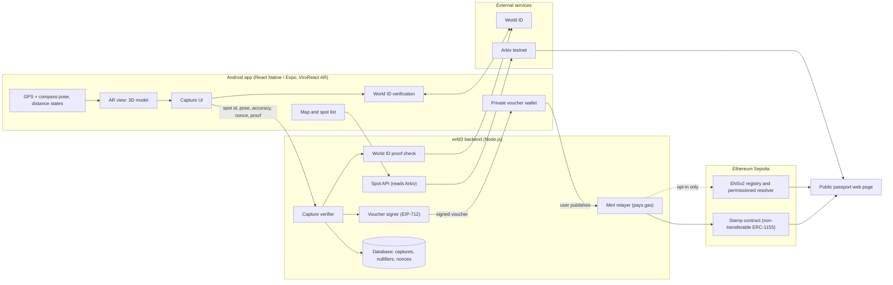
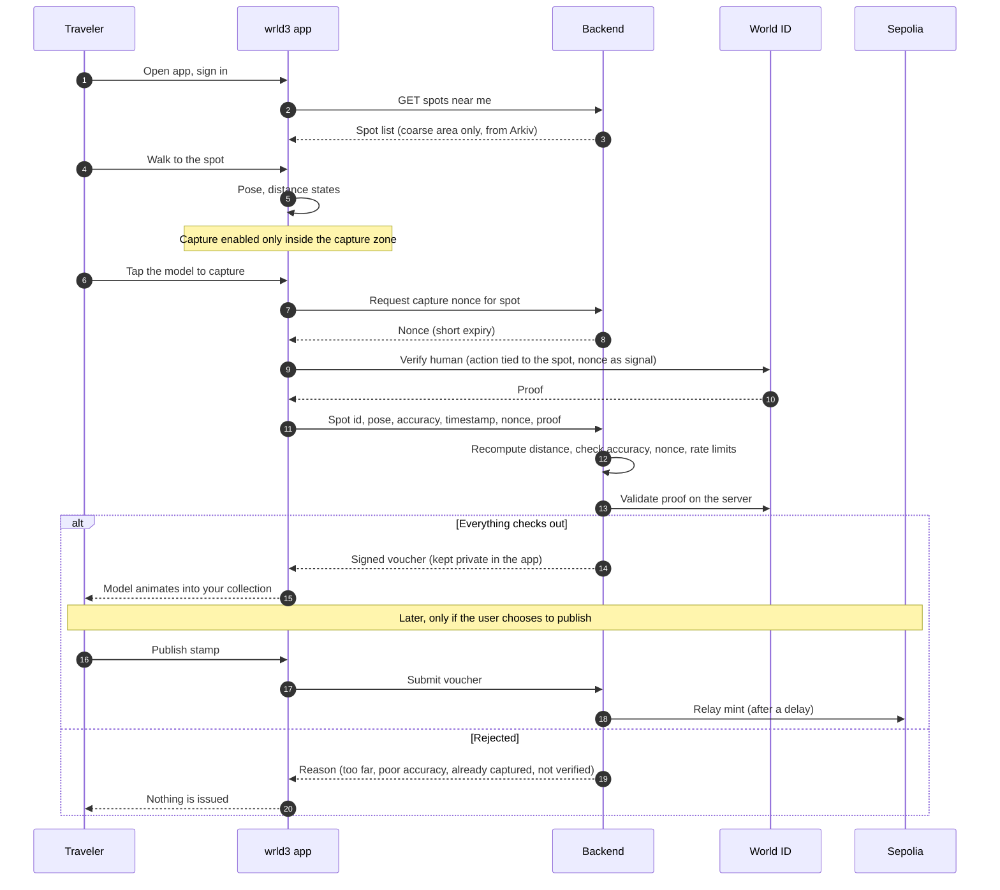
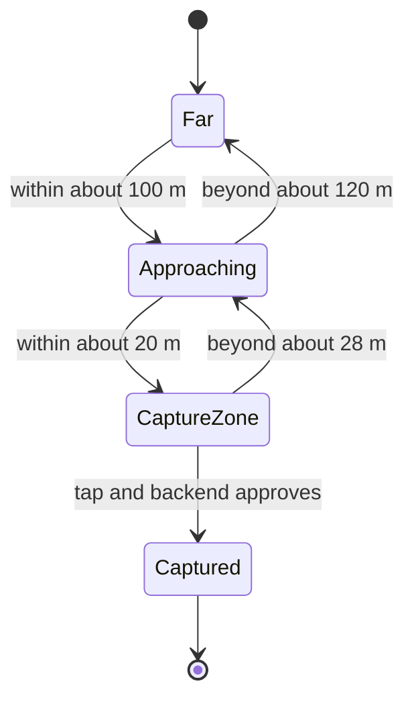

# wrld3

> **Go there. Prove it. Keep it.** Proof of Travel: a geopinned 3D collectible you can only capture by standing in the right place, as a verified human, and keep as an onchain passport stamp.

**Live:** [wrld3.vercel.app](https://wrld3.vercel.app) · [advertise](https://wrld3-sponsors.vercel.app) · [download the APK](https://github.com/anbusan19/world3/releases/latest)

Built for **ETHGlobal Mumbai** (Nov 5-7, 2026). Android app (React Native / Expo, AR capture), World ID, ENSv2, Arkiv, and a public web passport page.

> **Status: prototype.** Testnet only (Sepolia for contracts and ENS, Arkiv testnet), not audited. Items in the status table are ticked only after being verified on a real device.

* * *

## Table of contents

1. [Why "wrld3"](#why-wrld3)
2. [The problem](#the-problem)
3. [What wrld3 does](#what-wrld3-does)
4. [Architecture](#architecture)
5. [Capture flow](#capture-flow)
6. [Spot states: distance and the capture zone](#spot-states-distance-and-the-capture-zone)
7. [Proof of presence](#proof-of-presence)
8. [World ID: one human, one stamp](#world-id-one-human-one-stamp)
9. [ENSv2: the passport](#ensv2-the-passport)
10. [Arkiv: discoverable spots and campaigns](#arkiv-discoverable-spots-and-campaigns)
11. [The stamp token](#the-stamp-token)
12. [Privacy](#privacy)
13. [Security model](#security-model)
14. [Design](#design)
15. [Tech stack](#tech-stack)
16. [Repository structure](#repository-structure)
17. [Getting started](#getting-started)
18. [Demo script (3 minutes)](#demo-script-3-minutes)
19. [Build plan](#build-plan)
20. [Status](#status)
21. [Open questions and known limitations](#open-questions-and-known-limitations)
22. [Roadmap](#roadmap)
23. [Hackathon](#hackathon)
24. [Author and license](#author-and-license)

* * *

## Why "wrld3"

Web3 put ownership on the internet. wrld3 puts it on the physical world: places you have actually been become things you actually own. It started as POAP (proof of attendance) and grows into proof of **travel**, from a hackathon venue to a tourist landmark anywhere on the map.

## The problem

POAP proved a good idea: a record that you were somewhere. It faded because of three things:

- **The artifact was a flat image** with no reason to come back to it.
- **Claiming was a chore.** Scan a QR code, get an email, set up a wallet.
- **Anyone could fake it.** Location rewards are farmed by bots and by people spoofing GPS from their sofa, so a stamp proves little.

Any reward tied to being somewhere has the same weakness. If presence can be faked, the collectible means nothing.

## What wrld3 does

- **Spots.** A venue, landmark or memorabilia item is pinned in the real world with a 3D model. Spots and sponsor campaigns are published as public Arkiv entities.
- **Capture.** You walk up to it, see it through your phone camera, and tap to capture it.
- **Proof.** The capture needs a location fix and a **World ID** proof of unique personhood, checked by the backend, not trusted from the phone.
- **Keep.** A capture gives you a signed voucher that stays private in your app. You choose when to mint it as a **non-transferable stamp**. Your **ENS name is your passport**, and you choose whether it shows your stamps.

Wallets are invisible at capture time: sign in, tap, done.

* * *

## Architecture



**Design rules**

- The phone is never the source of truth for where it is. It sends evidence, and the **backend decides**.
- The contract mints only against a valid backend signature, so verification logic can change without redeploying. This means minting depends on the backend signer (see the security model).
- The **ERC-1155 contract is the source of truth** for stamps. ENS records are a derived, opt-in view.

## Capture flow



## Spot states: distance and the capture zone

The model behaves differently depending on how close you are. The numbers below are starting values to tune on a real device.



| State | What the user sees |
|---|---|
| **Far** | A map pin and a direction arrow. No model. |
| **Approaching** | The model appears in AR, dimmed and locked. |
| **CaptureZone** | The model is solid and tappable. The Capture button is enabled. |
| **Captured** | The model animates into the collection. |

Details that matter:

- **Hysteresis.** Enter at 20 m, leave at 28 m, so the button does not flicker at the edge (planned; the current app has the three states without hysteresis).
- **Accuracy gate.** If reported accuracy is worse than the threshold, the app says "improve your signal" instead of enabling capture.
- **Off-screen guidance.** If the spot is not in view, an arrow points toward it.

* * *

## Proof of presence

GPS alone is not enough. It is typically off by several metres outdoors, worse between tall buildings, and easy to spoof. wrld3 treats presence as **evidence weighed by the backend**, never a guarantee.

| Spot type | Used for | How presence is established |
|---|---|---|
| **Anchor spot** (current) | The hackathon venue and anywhere a marker can be placed | Phone location plus a scanned QR whose code **rotates** and is shown at the venue. The model is placed by ARCore using GPS and compass. Reliable on stage. |
| **Geospatial spot** (roadmap) | Outdoor landmarks | ARCore Geospatial API (GPS blended with VPS). Not implemented. VPS coverage at candidate sites is unconfirmed. |

**Backend checks on every capture**

1. Recompute the distance from the reported pose. Do not trust a distance computed on the phone.
2. Reject poor accuracy and stale timestamps.
3. Require a fresh, single-use nonce issued by the server.
4. Rate-limit per device and per account.
5. Reject mocked-location flags. Play Integrity is an optional extra signal only: sideloaded APK builds may not pass app-recognition checks.
6. For anchor spots, require the rotating venue code, so a photo of yesterday's QR fails.

**Known limits.** A rotating code can still be relayed live to a friend, a camera pointed at a screen may fool visual checks, and a modified app can send a false pose. World ID limits how many stamps one person can farm; it does not prove where they stand.

## World ID: one human, one stamp

Bots and farms are the reason location rewards fail. wrld3 uses **World ID (IDKit)** so each capture belongs to a unique human.

- **The trust moment:** the backend must know a real, unique person is claiming a spot before it signs a voucher.
- **Credential:** Proof of Human, chosen as the **minimum sufficient assurance**. A passport or selfie check would add friction without adding anything this use case needs.
- **Per-spot uniqueness:** the proof is tied to the spot, so one human can capture a given spot once. The backend stores the nullifier per spot and refuses repeats regardless of wallet.
- **Replay protection:** the server-issued nonce is part of the proof signal, so a proof cannot be reused with a different capture request.
- **Server-side verification:** the backend validates every proof. A client response is never treated as authorization.
- **Real proofs:** testing uses a real World ID. Where the simulator is used, the demo and README say so.
- **Failure paths shown in the demo:** an unverified user is refused, and a second capture of the same spot by the same human is refused. Nothing is issued in either case.
- **Integration debrief:** time to first success, friction, doc gaps and the single highest-impact improvement are logged in `WORLD_FEEDBACK.md`.

World ID's proofs are zero-knowledge: they show you are a unique human without revealing who you are.

How per-action uniqueness is exposed in the current IDKit, and how verification returns on native Android, are still to be confirmed against the docs.

## ENSv2: the passport

Your ENS name is your passport. This is central to the product, not a display feature.

- **Passport name.** Each traveler gets a **generated pseudonymous subname** under the project's parent name (no real names), so a passport is readable and portable instead of `0x84...`.
- **Limited write permission.** The backend is granted the right to edit **only stamp-related records** on a traveler's name, through ENSv2's Enhanced Access Control and a Permissioned Resolver. The traveler owns the name. The backend cannot take it, transfer it or change anything else.
- **Proof, not a claim.** The repo includes a test showing the backend **can** write its allowed record and **cannot** edit other records or move the name.
- **Opt-in stamp records.** Writing stamps to ENS happens only if the traveler enables passport sharing. Stamps are private by default.
- **ENS is a view, not a ledger.** ENS text records cannot be listed without knowing their keys (to be confirmed for the permissioned resolver), so the passport page builds the stamp list from the ERC-1155 contract and the spot list from Arkiv. ENS records hold the traveler's chosen summary or pointer.
- **Expiring and event-scoped names.** ENSv2 subnames can be expiring, revocable, or non-transferable, which fits event passes that should lapse and permanent stamps that should not.
- **Public passport page.** A shareable web page resolves an ENS name and renders its stamps. It is also the **live demo link**.

All of this runs on **ENSv2 on Sepolia** for the hackathon. These choices come from the ENSv2 feature set and are still to be validated against the current docs while building.

## Arkiv: discoverable spots and campaigns

Spots and sponsor campaigns are public entities on **Arkiv testnet**, so any app can discover them without asking wrld3's backend.

- **Sponsor-owned campaigns.** Each sponsor's own wallet writes its campaign entity. The backend only reads. Campaign windows map to entity expiry, so a campaign ends on schedule.
- **Spots.** Public spot entities carry a coarse display location, type, title and asset URI.
- **Geo queries.** Entities carry a geohash cell as a string for equality lookups and integer-scaled coordinates as numbers for range filters. Fuzzy name search is not an Arkiv feature; the app searches a small cached list.
- **Never on Arkiv:** user captures, nullifiers, GPS evidence, identity proofs, voucher data or wallet secrets.
- **In-app feature:** the map and spot list are populated by real Arkiv reads after a real Arkiv write.
- **Expiry:** entity lifetimes are set longer than the demo, with `expires_at` tracked locally. Renewal behavior is to be confirmed in the docs.
- **Why Arkiv, not a database:** records are wallet-owned, queryable by anyone including other apps and AI agents, and expire on schedule. If the wrld3 backend disappears, spots and campaigns remain discoverable.

The required Arkiv documents live in `/arkiv`: `schema.md`, `friction.md`, `reach.md`, `why-arkiv.md`, `how-you-use-arkiv.md`.

## The stamp token

The proof is a token, and the chain stays invisible to the user.

- **Standard:** ERC-1155. Each spot is a token id.
- **Non-transferable:** transfers and approvals revert, so a stamp keeps meaning "I was there". A tradable layer is out of scope.
- **One per verified human per spot.** Stamps are not scarce editions; the guarantee is uniqueness per human.
- **Mint authorization:** the contract mints only against an **EIP-712 voucher** signed by the backend. The voucher includes `chainId`, `verifyingContract`, `spotId`, `recipient`, `nonce` and `deadline`, and nonces are marked used in the contract.
- **Mint on demand:** a capture issues a voucher that stays private in the app. Minting happens when the user publishes, and the backend relays it **after a delay** so the chain does not reveal where someone is right now.
- **Gasless:** the backend relays the mint transaction and pays gas on Sepolia. No paymaster or wallet-provider dependency is needed. Wallet creation uses a simple key managed by the app for the hackathon; the provider and its recovery model are an open question.
- **Metadata:** the 3D model and preview image are stored on IPFS or any static host. Token metadata holds the spot name and timestamp bucket. **Exact coordinates are never put onchain.**

* * *

## Privacy

A public travel history reveals where someone lives, when they are away, and their routine. wrld3 is built around that risk, and is honest about what it cannot hide.

| Leak | How it identifies someone | What wrld3 does |
|---|---|---|
| Stamps on a public chain | An address received a stamp for a spot at a time | Private by default; mint on demand |
| Real-time minting | "This address is at venue X right now" | Delayed, relayed minting |
| ENS passport name | Ties an address to a person | Generated pseudonymous names, no PII |
| ENS records | Duplicate the visited places publicly | Opt-in only |
| Sensitive spots | A clinic, school or home-adjacent pin | Spots are moderated; no private or sensitive places |
| The backend | Sees the full capture history | Cannot be removed. Stated plainly below |

- **No coordinates onchain**, and no exact location in token metadata.
- **Location evidence stays off-chain** and is discarded after verification, apart from what the backend needs to prevent reuse (nullifier, nonce, spot id).
- **World ID reveals nothing about who you are,** only that you are a unique human.
- **Consent first.** Camera and location are requested with plain explanations.

**What we claim:** stamps are private until you choose to publish them, and World ID proves uniqueness without revealing identity.
**What we do not claim:** anonymity. Published stamps are public onchain, and the backend sees your capture history.

* * *

## Security model

| Component | Trusted? | Notes |
|---|---|---|
| The phone | **No** | Sends evidence only. A rooted or spoofed device is assumed possible. |
| The backend | **Yes, for decisions** | Verifies evidence, validates World ID, signs vouchers, relays mints. Compromise of its signing key would let it mint, so the key is held separately and can be rotated. |
| World ID | Yes | Provides unique-human proofs, verified server-side. |
| The contract | Partly | Transfers are impossible. Minting depends entirely on the backend signer. |
| ENS | Yes | The backend can only write stamp records, by permission, never own or move a name. |
| Arkiv | Public data only | Anyone can read. Sponsors own their campaign entities. |

**Honest caveats:** presence is probabilistic. A determined attacker with a screen and a camera may fool visual checks, and World ID limits how many stamps one person can farm instead of proving where they stand. The project has not been audited.

## Design

- Sharp corners, no gradients, no decorative weight. The collectible and the map are the interface.
- Anything a user could verify (addresses, token ids, ENS names, distances, timestamps) is set in a monospaced face.
- Failure states are plain and specific: "too far", "poor GPS signal", "already captured", "not verified". Never a silent no-op.
- The capture moment is the one place for motion: the model animating into the collection.

* * *

## Tech stack

| Layer | Choice |
|---|---|
| Mobile app | React Native with an **Expo development build** (not Expo Go), Android first |
| AR | **ViroReact** on ARCore (GPS and compass placement; Geospatial/VPS is roadmap) |
| 3D assets | glTF / GLB, compressed, roughly 2 to 5 MB each |
| Anchor spots | QR scan with a rotating venue code |
| Human check | **World ID IDKit**, verified on the backend |
| Identity | **ENSv2** (permissioned registry and resolver, Enhanced Access Control) on Sepolia |
| Public records | **Arkiv** testnet, SDK on the backend |
| Contracts | Solidity, ERC-1155 stamp with EIP-712 vouchers, Foundry |
| Chain | Ethereum Sepolia |
| Backend | Node.js (zero-dependency server today; Fastify and TypeScript optional) |
| Database | SQLite or JSON for the demo |
| Storage | IPFS or a static host for models and metadata |
| Passport page | Static web app that resolves ENS and renders stamps |

iOS is out of scope for the hackathon. Android builds are shared as an APK.

## Repository structure

Planned layout. Adjust as things are built.

```
wrld3/
├── App.js, app.json           # Expo app entry and config
├── src/
│   ├── ArModel.js             # ViroReact AR scene
│   ├── spots.js               # spot data and distance states
│   └── screens/               # sign-in, capture, passport, map
├── backend/
│   └── src/                   # spots API, capture verifier, World ID, voucher signer, relayer, arkiv adapter
├── contracts/                 # Stamp.sol, tests, deploy scripts (planned)
├── passport/                  # public passport web page (planned)
├── arkiv/                     # schema.md, friction.md, reach.md, why-arkiv.md, how-you-use-arkiv.md
├── landing/                   # landing page
├── docs/                      # diagrams, spot-authoring guide
├── WORLD_FEEDBACK.md          # IDKit integration debrief
└── README.md
```

## Getting started

**Just want the app?** Download the APK from the [latest release](../../releases/latest); see [docs/install.md](docs/install.md) for requirements and install steps.

### Prerequisites

- Node.js and an Android development environment (Android Studio, Expo development build)
- A **real Android phone** with ARCore support (emulators cannot exercise AR)
- A World ID developer-portal app and a verified World ID
- An Ethereum Sepolia RPC URL and a funded deployer key
- A parent ENS name on the ENSv2 Sepolia setup
- Arkiv testnet access (access key and faucet funds)

### Environment variables

`backend/.env`

```
PORT=3000
ARKIV_RPC_URL=<arkiv testnet endpoint>
ARKIV_ACCESS_KEY=<from the Arkiv access-key page>   # keep out of git
CHAIN_RPC_URL=<sepolia rpc>
STAMP_CONTRACT=<deployed address>
VOUCHER_SIGNER_KEY=<backend signing key>            # keep out of git
RELAYER_KEY=<funded Sepolia key for mint relay>     # keep out of git
WORLD_ID_APP_ID=<from the developer portal>
WORLD_ID_RP_SECRET=<server-side secret>             # keep out of git
ENS_PARENT_NAME=<parent>.eth
CAPTURE_RADIUS_M=20
CAPTURE_RADIUS_EXIT_M=28
MAX_ACCURACY_M=25
NONCE_TTL_SECONDS=60
MINT_DELAY_SECONDS=<tuned for the demo>
```

`app` (build-time config)

```
EXPO_PUBLIC_API_URL=https://<your-backend>
```

Never commit `.env` files, keys or signing secrets.

### Run

1. Deploy `Stamp.sol` to Sepolia and set `STAMP_CONTRACT`.
2. Start the backend: `cd backend && npm install && npm run dev`.
3. Create and install a React Native Android development build (not Expo Go) and start the app via Expo.
4. Seed one ordinary spot, one anchor spot and one sponsor campaign; publish them as Arkiv entities.
5. Walk to the anchor spot and capture on a real phone.
6. Deploy the passport page and open a traveler's ENS name.

* * *

## Demo script (3 minutes)

| Time | What is shown |
|---|---|
| 0:00-0:20 | **Problem:** stamps get faked by bots and spoofed GPS. One-line pitch: "Go there. Prove it. Keep it." |
| 0:20-0:45 | **Discover:** spots and a labeled sponsor campaign come from Arkiv. Run the public Arkiv query live and show it works without the backend. |
| 0:45-1:35 | **Capture at the venue:** scan the rotating anchor code, tap the model, verify with World ID, and the model animates into the collection. |
| 1:35-2:05 | **Refusals:** an unverified user is refused, and the same human capturing the same spot twice is refused. Nothing is issued. |
| 2:05-2:30 | **Publish:** choose to publish a stamp, show the delayed mint on the explorer, and note that the capture stayed private until then. |
| 2:30-2:55 | **Passport:** open the ENS name on the public page, show the stamps, and show the test proving the backend can edit only stamp records. |
| 2:55-3:00 | **Close:** what is real and what is mocked, plus the roadmap. |

Tips: record on the real device, show the capture zone transition in one take, and state clearly which proofs are real World ID proofs and anything that is simulated.

## Build plan

Work in this order. Later phases start only when earlier ones work end to end.

| Phase | Work | Done when |
|---|---|---|
| 0 | ENS spike on Sepolia | Backend writes its allowed record and is refused on anything else |
| 1 | Core Android flow: capture verifier, real World ID with both refusal paths, stamp contract with voucher, mint on demand | A real capture issues a voucher and a stamp mints on Sepolia |
| 2 | ENS passport records (opt-in) and the web passport page | A fresh name resolves live and lists stamps |
| 3 | Arkiv with sponsor-owned campaign entities and map reads | Entity written, queried and shown in the app |
| 4 | Privacy basics: delayed minting, generated names, spot moderation | Visible in the demo |
| 5 | Required files and a full demo recording | Checklist complete |
| 6 | Saturation checkpoint | Core works, one clean take recorded |
| 7 | Web lite capture, then the photo/memory tier | Only if phases 0 to 5 are solid |

A freeze point before the deadline limits work to bug fixes, recording and docs.

## Status

The React Native / Expo Android app shell exists. The integrations below remain unverified and are ticked only after running on a real device.

| Feature | Status |
|---|---|
| React Native Android development build with ViroReact AR scene | [x] |
| 3D model load and placement by GPS and compass | [x] verified on a real device (not Geospatial) |
| Spots server and dashboard | [x] (local storage, not Arkiv yet) |
| Spot distance states with hysteresis | [ ] states work, hysteresis missing |
| QR anchor with rotating venue code | [ ] scanning exists, no code verification |
| Backend capture verifier (distance, accuracy, nonce) | [ ] |
| World ID verification with server-side check | [ ] |
| Refusal paths (unverified, repeat capture) | [ ] |
| Voucher issuance and stamp mint on Sepolia | [ ] |
| Mint relay and delayed minting | [ ] |
| ENSv2 passport name and permissioned stamp records | [x] app flow built (opt-in "Create my public passport" on the Passport tab; server creates the name and publishes stamps, updates after each capture; the backend holds the name's owner key for now). Proof:  `wrld3.eth` registered on Sepolia; a passport's own resolver lets the backend write only `world3.stamps` and nothing else (proved on-chain by `backend/scripts/ens-spike.mjs`). Created by a real person's request on a real phone: not yet tested |
| Public passport page | [x] `/p/<name>` reads the stamps from ENS in the visitor's browser (try `/p/spikef99n`); needs a passport created through the app flow, not built yet |
| Arkiv spot write and in-app read | [x] two spots live on Rabdi, shown in the app as "Listed on Arkiv" and a demo sponsor campaign shown after a verified capture (payouts not built) |
| Geospatial pose and VPS availability check | [ ] roadmap |
| Web lite capture and photo/memory tier | [ ] roadmap |

## Open questions and known limitations

- **IDKit on native Android:** whether verification runs natively or needs a handoff to a browser or the World app is unconfirmed.
- **Per-spot uniqueness:** how the current IDKit exposes it needs confirming.
- **ENSv2 specifics:** registry layout, permission roles, expiry, and whether the permissioned resolver allows listing records are to be validated against the docs.
- **Arkiv specifics:** attribute types and limits, renewal, and ownership rules are to be validated against the docs. Arkiv is testnet only.
- **Wallet provider and recovery** for the traveler's key are not chosen.
- **VPS coverage** at the venue and at candidate landmarks is unconfirmed.
- **Presence is evidence, not proof.** See the security model.
- **Privacy:** published stamps are public onchain and the backend sees capture history.
- **Prototype scope.** Android only, testnet only, not audited.

## Roadmap

- **Web lite capture** (works on iOS and desktop, lower trust tier): browser location, a 3D viewer, the rotating venue code and World ID. Stamps are marked as a lower tier than AR captures.
- **Past travel (memory) tier:** import an old photo, read EXIF on the device, check it against the spot, and issue a clearly labeled **self-attested "memory"** stamp with no sponsor rewards. EXIF is editable, so this tier is never presented as proof. Stronger evidence tiers follow: photos carrying a verified device signature (C2PA content credentials), and existing onchain attendance records.
- **Zero-knowledge extensions:** anonymous stamp groups and threshold proofs ("I completed trail T") without revealing which spots. A zero-knowledge location proof adds little without a trusted location source, so it is not planned.
- Geospatial / VPS outdoor spots and tourist landmarks worldwide, added city by city through local partners
- Spot authoring tools with a review step so no spot is pinned somewhere unsafe or private
- Organizer and tourism-board sponsored spots with capture counts (claims and redemptions reported separately; an AR claim does not establish a visit or a purchase)
- Passport progress: country and region completion, and unlocks tied to travel history
- iOS support
- Mainnet deployment after an audit
- Optional tradable layer on top of stamps, only if people clearly want it

## Hackathon

Built for **ETHGlobal Mumbai**.

> **Disclosure (confirm and edit before submitting):** the Android app shell (Expo, ViroReact AR rendering, spots server and landing page) was scaffolded before the event. The backend verifier, World ID, stamp contract, ENS passport, Arkiv integration and passport page are built during it.

| Sponsor | Integration |
|---|---|
| **World** | IDKit proof of human on every capture, verified on the backend, with demonstrated refusal paths and an integration debrief |
| **ENS** | ENSv2 passport on Sepolia: generated subname per traveler, permissioned stamp records with a permission test, live passport page as the demo link |
| **Arkiv** | Spot and sponsor-campaign entities written to Arkiv testnet by their owners, with an in-app feature that reads them |

**Arkiv, for judges.** Writer wallet: `0xf47cB2e4353F5daF04fA7AF0955551ab7DB74b52` (Rabdi testnet, chain id 7794095). Run one query with no
wrld3 server: `cd backend && npm install && node scripts/arkiv-query.mjs`. Details in [`/arkiv`](arkiv/). Sponsor campaigns (ads written by sponsors' own wallets from the advertiser page `/sponsor.html`, approved by the organizer on `/sponsors.html`, shown after a verified capture) are built; escrow and payouts are **not**. See
[`docs/ads-and-campaigns.md`](docs/ads-and-campaigns.md).

Submission checklist:

- Public repo with an open-source license and an AI-usage statement
- Live demo link (the passport page) and a demo video
- README sections: how each sponsor is used, wallet addresses that wrote Arkiv entities and one runnable query
- `/arkiv/*.md` files and `WORLD_FEEDBACK.md`
- Clear labels for anything mocked or simulated

wrld3 is an independent project. It uses World ID but is **not affiliated with World**.